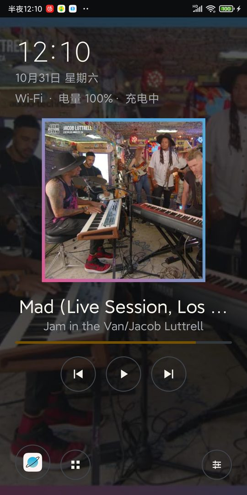
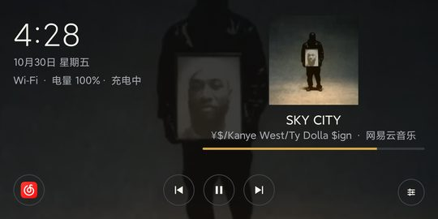
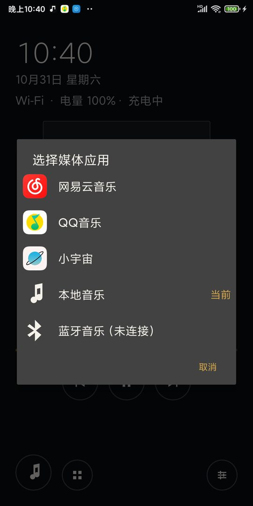
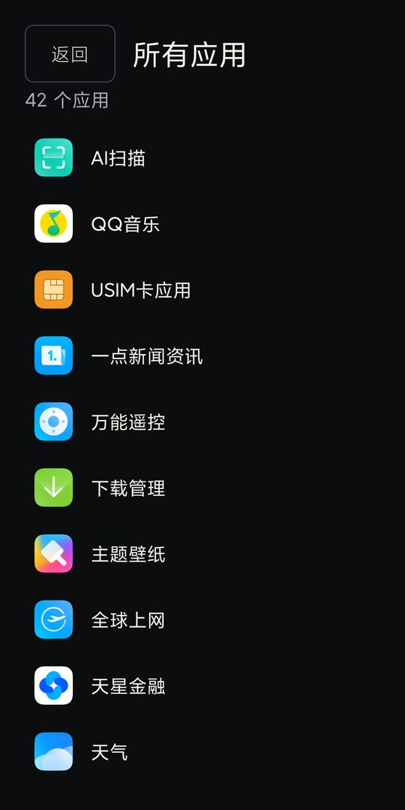
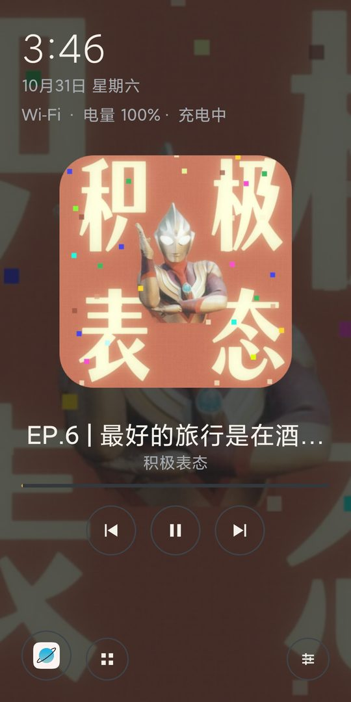
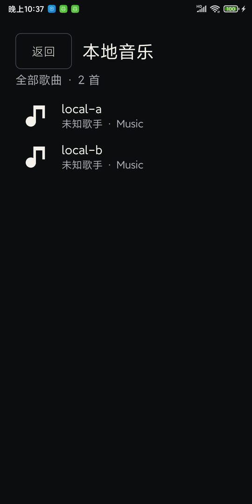
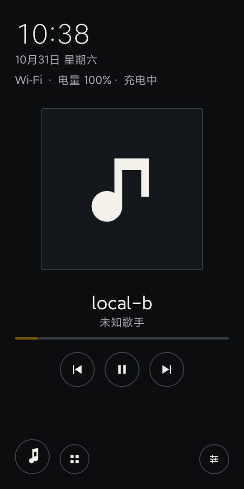
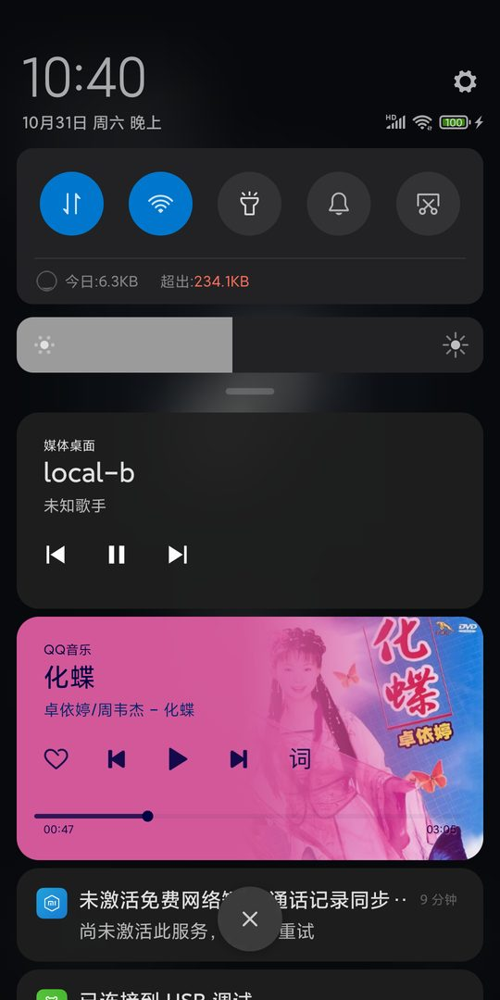
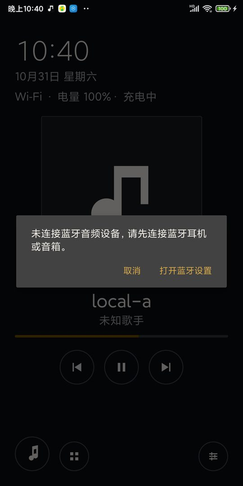

# 媒体桌面（RefreshOldPhone）

把闲置的 Android 手机或平板变成一台安静、专注的媒体设备：无广告、无推荐、无需 root、无需刷机，默认桌面可随时恢复。

应用本身只提供轻量 HOME 桌面、设备状态和跨应用播放状态展示；音乐与播客仍由你已安装的官方 App（网易云音乐、QQ 音乐、小宇宙等）播放，本项目不重做登录、会员、版权或播放能力，也不下载、不分发第三方 APK。

当前版本：0.1.0（MVP，最低 Android 6.0 / API 23）。

## 功能

- **可选 HOME 桌面**：安装后可先作为普通 App 使用；在设置里选择默认桌面后才接管 HOME 键，随时可以恢复 MIUI/系统桌面。
- **紧凑媒体源入口**：首页只保留一个小的媒体源图标（默认显示最近使用的媒体 App 图标），点击弹出列表，在设备已安装的媒体应用之间切换；列表只显示已安装的媒体源，不占桌面空间，未安装的官方应用不会显示为空位。
- **所有应用入口**：媒体源图标右侧有一个网格图标，点击打开应用抽屉，列出手机中所有可启动应用（排除本桌面自身），按名称排序，点击直接启动。
- **单源互斥播放**：当已接入的媒体源开始播放时，自动暂停其他已接入源的播放（通过 MediaSession 暂停，不强制关闭应用）；桌面可见时立即生效，离开桌面后由进程级守卫继续执行。
- **本地音乐**：内置播放器扫描系统音频库，提供全部歌曲列表、封面、播放/暂停、上一首/下一首和进度；前台服务 + MediaStyle 通知支持后台/锁屏继续播放，并接入单源互斥。
- **蓝牙音乐**：媒体源弹窗中的独立蓝牙输出源，显示已连接的 A2DP 设备名；选择后打开本地音乐库，音频由系统路由到蓝牙，耳机/车机按键通过 MediaSession/AVRCP 生效；未连接时提供蓝牙设置入口。
- **跨应用播放状态（可选）**：在系统设置中手动开启“通知使用权”后，读取系统暴露的 MediaSession，显示曲名、作者、封面、进度，并提供当前会话支持的播放/暂停、上一首、下一首控制；会话不支持的操作会隐藏或禁用。
- **封面背景**：有播放封面时，用当前封面作为全屏暗化背景（复用同一张已缩放的封面图，30% 不透明度，不做模糊/动画；无播放时保持纯黑），文字对比度不受影响。
- **Walkman 风格视觉**：近黑底 + 暖白细字时钟 + 圆形描边播放控制 + 琥珀色细进度条 + 方形封面；设置与媒体源入口使用描边/圆形按钮，保持 56dp 触控目标。
- **设备状态**：时间、日期、Wi-Fi/移动网络/离线、电量与充电状态。
- **沉浸式状态栏**：默认隐藏系统状态栏（桌面顶部自带时间/电量），从屏幕顶部下滑可临时唤出状态栏与通知；可在设置中恢复显示。只影响本桌面。
- **双方向布局**：竖屏以播放内容优先；横屏左侧为时钟、日期与设备状态，右侧为放大的封面与播放信息，播放控制固定在底部。
- **设置与出口**：方向（自动/固定竖屏/固定横屏）、保持屏幕常亮、隐藏系统状态栏、附加媒体应用、通知授权状态与入口、Wi-Fi/移动网络/蓝牙/音量/应用详情/系统设置快捷入口、选择默认桌面、恢复系统桌面、清除本地配置、版本与仓库链接。

## 界面

| 竖屏（播放优先） | 横屏（时钟 + 封面模式） |
| --- | --- |
|  |  |

视觉方向为 Sony Walkman 致敬：黑底、细字、圆形描边控制、琥珀色细进度条；有播放时封面同时作为全屏暗化背景，系统状态栏默认隐藏。点击左下角的媒体源图标切换不同的已安装媒体应用（当前来源会标记“当前”）：



应用抽屉（点击媒体源图标右侧的网格图标进入）：



小宇宙播放时（WebView Beta 实现）：



本地音乐库与播放卡片：




通知栏媒体控制：



蓝牙音乐未连接提示：



更多设置页、播放卡片与恢复流程截图见 [真机验收记录](docs/device-testing-mix2s.md)。

## 不包含（0.1 范围）

- 本地音乐的高级库功能：专辑、歌手、文件夹、搜索、歌单、随机/循环、无缝播放、歌词。
- RSS/Atom 播客订阅、下载与播放。
- 网络电台收藏与播放。
- 逆向第三方 App 私有接口、保存第三方账号/Cookie/令牌。
- 广告、账号系统、云同步、遥测或任何服务端。
- kiosk/Device Owner/Lock Task、root、停用或卸载系统应用。

## 环境要求

- Android 6.0（API 23）及以上；已在 Xiaomi MIX 2S（Android 10 / API 29，MIUI 12.5）验证。
- 构建：JDK 17、Android SDK Platform 36、Build-Tools 36.0.0、Gradle 9.6.0（仓库自带 wrapper）。

## 构建

1. 安装 Android SDK，并在仓库根目录创建不入库的 `local.properties`：

   ```properties
   sdk.dir=C\:\\path\\to\\android-sdk
   ```

2. 运行单元测试与构建：

   ```powershell
   .\gradlew.bat testDebugUnitTest
   .\gradlew.bat lintDebug
   .\gradlew.bat assembleDebug
   ```

3. 调试 APK 位于：

   ```text
   app\build\outputs\apk\debug\app-debug.apk
   ```

4. 安装到设备：

   ```powershell
   adb install -r app\build\outputs\apk\debug\app-debug.apk
   ```

> 离线/内网环境提示：若无法访问 Google Maven 与 Maven Central，可提前准备 Gradle 依赖缓存，并使用本地 Gradle 9.6.0 发行版执行 `gradle -g <GRADLE_USER_HOME> --offline assembleDebug`。

## 首次使用

1. 安装后先作为普通 App 打开，确认首页、时钟、状态和应用入口正常。
2. 打开“设置 → 选择默认桌面”，选择“媒体桌面”；按 Home 键即可返回。
3. 如需跨应用播放状态：打开“设置 → 通知使用权”，在系统页面允许“媒体播放状态”。应用只借此调用 `MediaSessionManager.getActiveSessions()`，不读取、记录或上传通知正文；随时可以关闭，关闭后桌面降级为纯启动器。
4. 按需调整方向、屏幕常亮，以及从已安装应用中添加其他媒体 App。
5. 点击左下角媒体源图标，在弹出的列表中选择已安装的媒体 App；按 Home 返回媒体桌面。
6. 点击媒体源图标右侧的网格图标可打开应用抽屉，查看并启动手机中的其他应用；按返回键回到媒体桌面。
7. 选择「本地音乐」并授予音频读取权限后，可在全部歌曲列表中点击播放；播放时桌面显示本地歌曲卡片，通知栏提供上一首/暂停/下一首。
8. 选择「蓝牙音乐」查看当前 A2DP 输出；未连接时会提示并提供“打开蓝牙设置”入口。连接后由系统把本地播放路由到蓝牙设备。

## 恢复系统桌面

1. 打开“设置 → 恢复系统桌面”，进入 Android 的默认桌面设置。
2. 选择“系统桌面 / MIUI 桌面”作为默认桌面。
3. 如果系统没有提供默认桌面选择器：打开系统“设置 → 应用 → 默认应用 → 主屏幕”，或清除本应用的默认设置。
4. 也可以在系统设置 → 应用中卸载本应用，设备即恢复原有桌面行为。

应用不会自动修改系统默认桌面，也不会阻止返回系统设置。

## 权限与隐私

- `ACCESS_NETWORK_STATE`：仅用于显示当前网络类型，不请求位置或 Wi-Fi SSID。
- `READ_MEDIA_AUDIO`（Android 13+）/ `READ_EXTERNAL_STORAGE`（Android 12 及以下）：仅在选择「本地音乐」并授予后读取系统音频库，用于显示歌曲与播放；不上传、不修改文件。
- `FOREGROUND_SERVICE` / `FOREGROUND_SERVICE_MEDIA_PLAYBACK` 与通知权限：仅用于本地播放的后台前台服务与 MediaStyle 通知；拒绝通知权限不阻塞播放。
- Notification Listener（通知使用权）：可选，由用户在系统页面明确开启；仅用于读取 MediaSession 的播放元数据与发送受支持的播放控制命令。
- 不申请通讯录、短信、电话、位置、相机、麦克风、蓝牙配对/连接等权限；蓝牙输出通过系统音频路由完成。
- 无服务器、无账号、无广告、无遥测；配置仅保存在本机 SharedPreferences，详见 [docs/privacy.md](docs/privacy.md)。

## 已知限制

- 只能展示和控制系统实际暴露的 MediaSession；部分 App 版本可能不暴露会话或只支持部分操作。
- 进度条在播放时按本地时间平滑推进（不轮询 MediaSession，暂停或离开桌面即停止；播放器上报新位置时会校准）。
- 横屏采用“封面模式”而非歌词模式：Android MediaSession 不提供歌词文本接口，本项目不读取通知正文、不逆向第三方私有接口；歌词能力留待本地音乐/LRC 里程碑。
- MIX 2S + 网易云音乐 9.6.15 上已验证官方 App 启动，以及授权后读取到其 MediaSession（曲名、作者、封面、播放进度与基础控制）；未安装的官方媒体应用不出现在媒体源列表，设置页仍可添加其他已安装媒体应用。
- MIX 2S 上已验证：播放中旋转不打断音频、锁屏/解锁后播放与首页恢复、进程冷启动、以及设为默认桌面后重启仍保留（详见 [真机验收记录](docs/device-testing-mix2s.md)）。
- 低内存、Android 6/7 32 位设备、非 MIUI 设备和 10 英寸以上平板尚未实测，属于后续兼容矩阵。
- 未授予通知使用权时，不显示跨应用播放卡片，其余功能不受影响。
- 播放状态读取以系统“通知使用权”授权为准，不依赖监听服务是否已绑定；因此应用更新、进程重建或设备重启后，只要授权仍在，无需重新切换授权即可继续显示播放状态。
- QQ 音乐 20.9.7.9（全功能模式，需登录）已验证会暴露 MediaSession，可正常显示与控制；其“基础模式”（不同意隐私协议）不注册 MediaSession，此时媒体桌面无法显示其播放卡片。
- 小宇宙 3.4.1 需要较新的 WebView：MIX 2S 原 Android System WebView 83 会导致登录页黑屏。本机已安装 Google 签名的 Android System WebView Beta 158（`com.google.android.webview.beta`）并切换实现，实测小宇宙可正常打开、播放，媒体桌面能显示其卡片、进度并参与单源互斥。恢复系统实现：`adb shell cmd webviewupdate set-webview-implementation com.google.android.webview`。
- 本地音乐首版只列系统媒体库中的“全部歌曲”，无专辑/歌手/文件夹/搜索/歌单/随机循环/歌词；损坏或系统不支持的音频会暂停并保留错误状态，不自动跳歌。
- 蓝牙音乐使用系统 A2DP 输出与 MediaSession/AVRCP；实际耳机/音箱的按键行为需硬件实测。MIX 2S 验收时没有已连接蓝牙音频设备，只验证了“未连接”提示与设置入口。

## 项目文档

- 设计规格：[docs/superpowers/specs/2026-10-29-old-android-media-shell-design.md](docs/superpowers/specs/2026-10-29-old-android-media-shell-design.md)
- 实施计划：[docs/superpowers/plans/2026-10-29-media-shell-mvp.md](docs/superpowers/plans/2026-10-29-media-shell-mvp.md)
- 隐私说明：[docs/privacy.md](docs/privacy.md)
- 发布检查清单：[docs/release-checklist.md](docs/release-checklist.md)
- 真机验收记录：[docs/device-testing-mix2s.md](docs/device-testing-mix2s.md)

## 许可

本项目使用 MIT 许可证，见 [LICENSE](LICENSE)。第三方 App 的内容、账号与版权归各自平台所有；本项目不提供、不下载、不分发任何第三方 APK。
