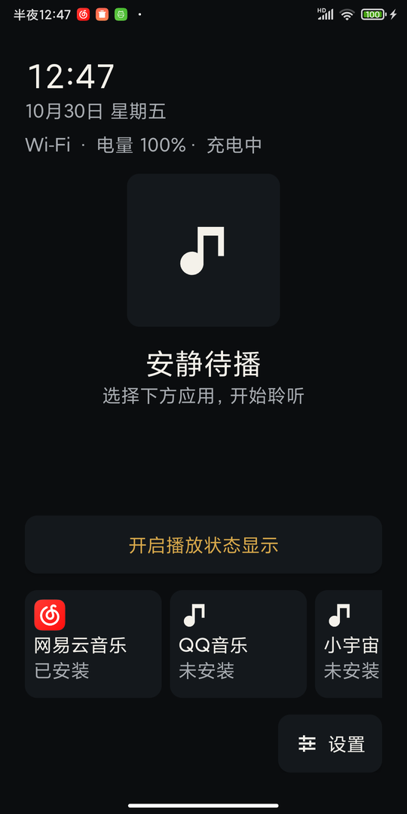
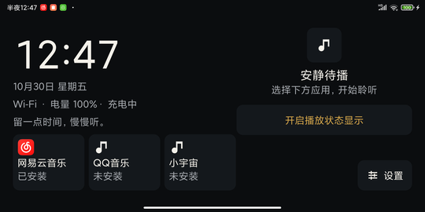
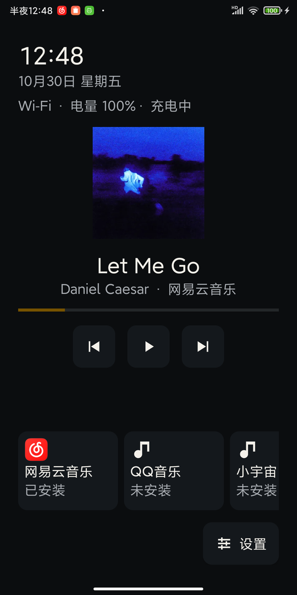

# 媒体桌面（RefreshOldPhone）

把闲置的 Android 手机或平板变成一台安静、专注的媒体设备：无广告、无推荐、无需 root、无需刷机，默认桌面可随时恢复。

应用本身只提供轻量 HOME 桌面、设备状态和跨应用播放状态展示；音乐与播客仍由你已安装的官方 App（网易云音乐、QQ 音乐、小宇宙等）播放，本项目不重做登录、会员、版权或播放能力，也不下载、不分发第三方 APK。

当前版本：0.1.0（MVP，最低 Android 6.0 / API 23）。

## 功能

- **可选 HOME 桌面**：安装后可先作为普通 App 使用；在设置里选择默认桌面后才接管 HOME 键，随时可以恢复 MIUI/系统桌面。
- **官方 App 入口**：固定展示网易云音乐、QQ 音乐、小宇宙；已安装可直接启动，未安装显示缺失状态并给出官方获取指引。
- **跨应用播放状态（可选）**：在系统设置中手动开启“通知使用权”后，读取系统暴露的 MediaSession，显示曲名、作者、封面、进度，并提供当前会话支持的播放/暂停、上一首、下一首控制；会话不支持的操作会隐藏或禁用。
- **设备状态**：时间、日期、Wi-Fi/移动网络/离线、电量与充电状态。
- **双方向布局**：竖屏以播放内容优先；横屏以大时钟和日期优先，播放信息紧凑排列在右侧。
- **设置与出口**：方向（自动/固定竖屏/固定横屏）、保持屏幕常亮、横屏静默文案、附加媒体应用、通知授权状态与入口、Wi-Fi/移动网络/蓝牙/音量/应用详情/系统设置快捷入口、选择默认桌面、恢复系统桌面、清除本地配置、版本与仓库链接。

## 界面

| 竖屏（播放优先） | 横屏（环境时钟优先） |
| --- | --- |
|  |  |

读取到官方 App 的 MediaSession 后：



更多设置页与恢复流程截图见 [真机验收记录](docs/device-testing-mix2s.md)。

## 不包含（0.1 范围）

- 本地音乐扫描与原生播放器。
- RSS/Atom 播客订阅、下载与播放。
- 网络电台收藏与播放。
- 逆向第三方 App 私有接口、保存第三方账号/Cookie/令牌。
- 广告、账号系统、云同步、遥测或任何服务端。
- kiosk/Device Owner/Lock Task、root、停用或卸载系统应用。

## 环境要求

- Android 6.0（API 23）及以上；已在 Xiaomi MIX 2S（Android 10 / API 29，MIUI 12.5）验证。
- 构建：JDK 17、Android SDK Platform 36、Build-Tools 36.0.0、Gradle 9.6.0（仓库自带 wrapper）。

## 构建

1. 安装 Android SDK，并在仓库根目录创建不入库的 `local.properties`：

   ```properties
   sdk.dir=C\:\\path\\to\\android-sdk
   ```

2. 运行单元测试与构建：

   ```powershell
   .\gradlew.bat testDebugUnitTest
   .\gradlew.bat lintDebug
   .\gradlew.bat assembleDebug
   ```

3. 调试 APK 位于：

   ```text
   app\build\outputs\apk\debug\app-debug.apk
   ```

4. 安装到设备：

   ```powershell
   adb install -r app\build\outputs\apk\debug\app-debug.apk
   ```

> 离线/内网环境提示：若无法访问 Google Maven 与 Maven Central，可提前准备 Gradle 依赖缓存，并使用本地 Gradle 9.6.0 发行版执行 `gradle -g <GRADLE_USER_HOME> --offline assembleDebug`。

## 首次使用

1. 安装后先作为普通 App 打开，确认首页、时钟、状态和应用入口正常。
2. 打开“设置 → 选择默认桌面”，选择“媒体桌面”；按 Home 键即可返回。
3. 如需跨应用播放状态：打开“设置 → 通知使用权”，在系统页面允许“媒体播放状态”。应用只借此调用 `MediaSessionManager.getActiveSessions()`，不读取、记录或上传通知正文；随时可以关闭，关闭后桌面降级为纯启动器。
4. 按需调整方向、屏幕常亮、横屏静默文案，以及从已安装应用中添加其他媒体 App。
5. 点击媒体 App 卡片启动对应官方 App；按 Home 返回媒体桌面。

## 恢复系统桌面

1. 打开“设置 → 恢复系统桌面”，进入 Android 的默认桌面设置。
2. 选择“系统桌面 / MIUI 桌面”作为默认桌面。
3. 如果系统没有提供默认桌面选择器：打开系统“设置 → 应用 → 默认应用 → 主屏幕”，或清除本应用的默认设置。
4. 也可以在系统设置 → 应用中卸载本应用，设备即恢复原有桌面行为。

应用不会自动修改系统默认桌面，也不会阻止返回系统设置。

## 权限与隐私

- `ACCESS_NETWORK_STATE`：仅用于显示当前网络类型，不请求位置或 Wi-Fi SSID。
- Notification Listener（通知使用权）：可选，由用户在系统页面明确开启；仅用于读取 MediaSession 的播放元数据与发送受支持的播放控制命令。
- 0.1 不申请通知发送、通讯录、短信、电话、位置、相机、麦克风、存储等权限。
- 无服务器、无账号、无广告、无遥测；配置仅保存在本机 SharedPreferences，详见 [docs/privacy.md](docs/privacy.md)。

## 已知限制

- 只能展示和控制系统实际暴露的 MediaSession；部分 App 版本可能不暴露会话或只支持部分操作。
- 进度条随播放状态/元数据事件更新，不做持续轮询，因此播放中可能不会逐秒前进。
- MIX 2S + 网易云音乐 9.6.15 上已验证官方 App 启动，以及授权后读取到其 MediaSession（曲名、作者、封面、播放进度与基础控制）；QQ 音乐、小宇宙未安装时以缺失状态展示。
- 低内存、Android 6/7 32 位设备尚未实测，属于后续兼容矩阵。
- 未授予通知使用权时，不显示跨应用播放卡片，其余功能不受影响。
- 实际音频播放中的旋转连续性、锁屏与重启持久化尚未在真机覆盖，见真机验收记录。

## 项目文档

- 设计规格：[docs/superpowers/specs/2026-10-29-old-android-media-shell-design.md](docs/superpowers/specs/2026-10-29-old-android-media-shell-design.md)
- 实施计划：[docs/superpowers/plans/2026-10-29-media-shell-mvp.md](docs/superpowers/plans/2026-10-29-media-shell-mvp.md)
- 隐私说明：[docs/privacy.md](docs/privacy.md)
- 发布检查清单：[docs/release-checklist.md](docs/release-checklist.md)
- 真机验收记录：[docs/device-testing-mix2s.md](docs/device-testing-mix2s.md)

## 许可

本项目使用 MIT 许可证，见 [LICENSE](LICENSE)。第三方 App 的内容、账号与版权归各自平台所有；本项目不提供、不下载、不分发任何第三方 APK。
